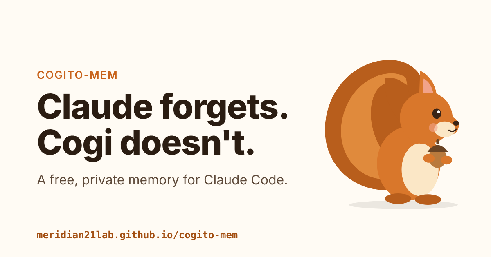

# cogito-mem

<!-- mcp-name: io.github.meridian21lab/cogito-mem -->

**Long-term memory for Claude Code, on your own machine.** Cogi the squirrel keeps every message you and Claude exchange, and brings back what Claude forgot. No API key, no cloud, no AI calls to store.



## Why try it

- **Claude stops forgetting.** Every message and reply is kept word for word, with its date. When something has dropped out of the context window, or happened last week, the relevant part comes back with your next prompt.
- **It remembers what you did, too.** The commands you ran (and whether they failed) and the files you touched, without their output.
- **Private and free.** One folder on your computer. No account, no API key, no AI calls to save a message. Nothing leaves your machine.
- **Tested.** On LongMemEval-S, the past session holding the answer is among the first five Cogi finds for 99.0% of 500 questions, with no AI model involved; other local memory plugins published 95.2–98.0% as of October 2026. On LoCoMo, the 1,000 tokens Cogi hands back answer 74.7% of questions right, level with rereading the whole conversation (76.5%). A search over 10 million tokens takes 26 ms on a laptop CPU. [See the results](https://meridian21lab.github.io/cogito-mem/results.html).

## Install

You need Claude Code and [uv](https://docs.astral.sh/uv/getting-started/installation/), on macOS or Linux (Windows is experimental). Then, in a terminal:

```sh
claude plugin install cogito-mem --marketplace meridian21lab/cogito-mem
```

The first start downloads the model (310 MB, about a minute). To get updates, turn on auto-update once: `/plugin` → *Marketplaces* → *cogito-mem* → *Enable auto-update*.

[Step-by-step guide](https://meridian21lab.github.io/cogito-mem/start.html) · [Codex, Claude Desktop, Docker](https://github.com/meridian21lab/cogito-mem/blob/main/docs/install.md)

## Try it

1. Tell Claude: *Let's call the staging server "acorn".*
2. Clear its short-term memory: `/clear`
3. Ask: *What did we call the staging server?* Claude answers "acorn": Cogi brought it back.

## What Cogi runs, downloads and stores

- **Runs:** four Claude Code hooks and one MCP server, `cogi`, each started with `uv run --frozen` from the plugin's own folder, at the exact package versions in its `uv.lock`. After each reply and at the end of a session, the hooks save the new messages from the session's transcript. At the start of a session and with each prompt, they add the few most relevant memories (at most 300 tokens per prompt). The MCP server gives Claude two tools, `memory_query` and `memory_append`, answered by a small service that listens on your computer only (`127.0.0.1:7327`).
- **Downloads, once, over HTTPS:** Cogi's one Python dependency, numpy, from PyPI (by uv); llama.cpp's `llama-server` from llama.cpp's official GitHub releases (skipped if you already have it); and the EmbeddingGemma 2 model (310 MB) from Hugging Face. After that, Cogi makes no network calls.
- **Stores:** everything in `~/.cogito-mem/` on your computer: your messages, and a short note of what each turn did, in one SQLite file. API keys, tokens, private keys and passwords are replaced with `[redacted]` before anything is saved; tool output and file contents are never saved. Text inside `<private>…</private>` is skipped, and `COGITO_MEM_CAPTURE=off` pauses saving.
- **Sends:** nothing. No account, no analytics, no telemetry.
- **Removes cleanly:** `claude plugin uninstall cogito-mem@cogito-mem`, then delete `~/.cogito-mem`.

Every file, download and connection, with links to the source: [What you install](https://meridian21lab.github.io/cogito-mem/safety.html).

## How it compares

| | cogito-mem | [claude-mem](https://github.com/thedotmack/claude-mem) | [Mem0 plugin](https://github.com/mem0ai/mem0/tree/main/integrations/claude-code-plugin) | [cognee plugin](https://github.com/topoteretes/cognee-integrations) | [Supermemory plugin](https://github.com/supermemoryai/claude-supermemory) |
|---|---|---|---|---|---|
| AI calls to store a message | **none** | an observer model per tool call (Haiku on your Claude plan by default) | extraction on Mem0's servers | extraction with your LLM key or `claude -p` | in Supermemory's service |
| Account or API key | **none** | optional sign-in | Mem0 Platform API key | an LLM key or the Claude CLI | API key or login |
| Where your memory lives | **your computer** | your computer (cloud sync optional) | Mem0's cloud | your computer (cloud optional) | Supermemory's cloud (local mode available) |
| What comes back | **your exact words, with dates** | AI-written observations | extracted memories | graph facts and summaries | extracted memories |
| Searchable after | **the same turn** | the observer's run | a batch (every 5 exchanges) | the next graph run | the background save |

Keep your project's rules in `CLAUDE.md`, and let Cogi remember what happened.

## Learn more

| | |
|---|---|
| [How it works](https://meridian21lab.github.io/cogito-mem/how.html) | Collect, keep, find: what Cogi stores and how it finds it |
| [Results](https://meridian21lab.github.io/cogito-mem/results.html) · [Benchmarks](https://github.com/meridian21lab/cogito-mem/blob/main/docs/benchmarks.md) | The numbers, and how to reproduce them |
| [API & MCP](https://meridian21lab.github.io/cogito-mem/api.html) · [Reference](https://github.com/meridian21lab/cogito-mem/blob/main/docs/reference.md) | HTTP, Python, terminal, settings, FAQ, roadmap |
| [What you install](https://meridian21lab.github.io/cogito-mem/safety.html) · [Privacy](https://meridian21lab.github.io/cogito-mem/privacy.html) | Every file, download and connection |
| [Development](https://github.com/meridian21lab/cogito-mem/blob/main/docs/development.md) | Running the tests and the evaluations |

> **Early access.** v0.2 is new, built and tested (over 200 tests), and still being measured. Feedback and [issues](https://github.com/meridian21lab/cogito-mem/issues) are very welcome.

## License

[MIT](https://github.com/meridian21lab/cogito-mem/blob/main/LICENSE)
